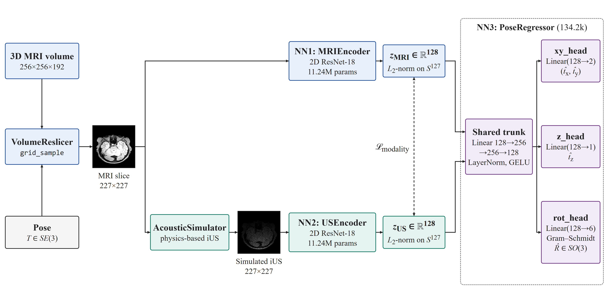
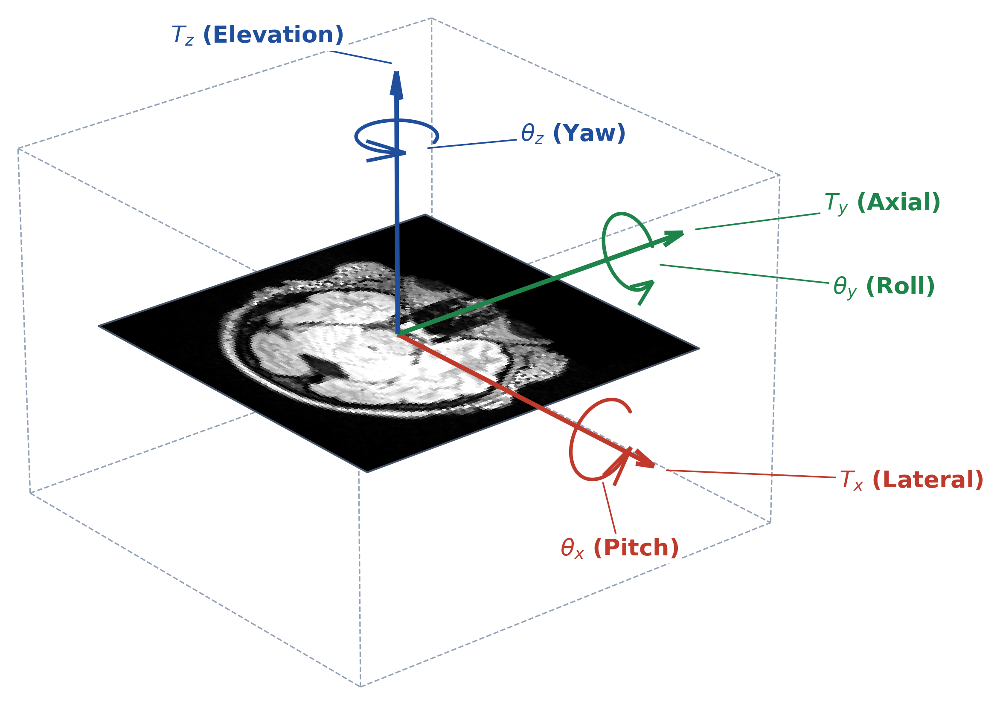
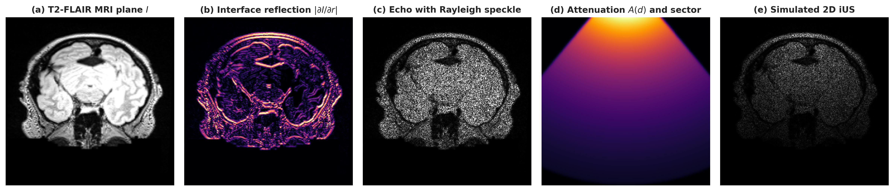
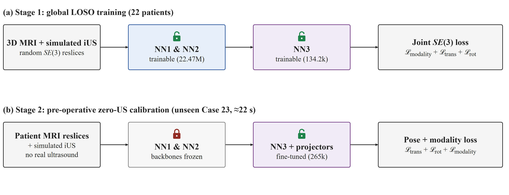
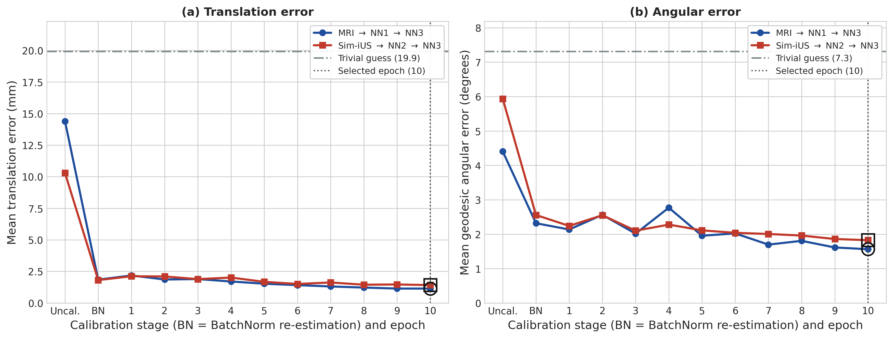
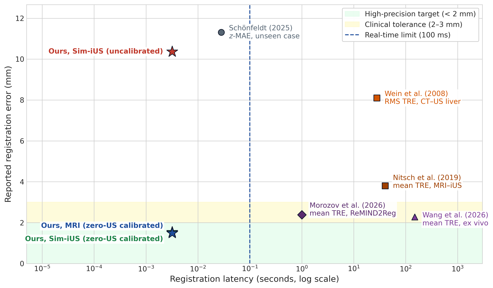
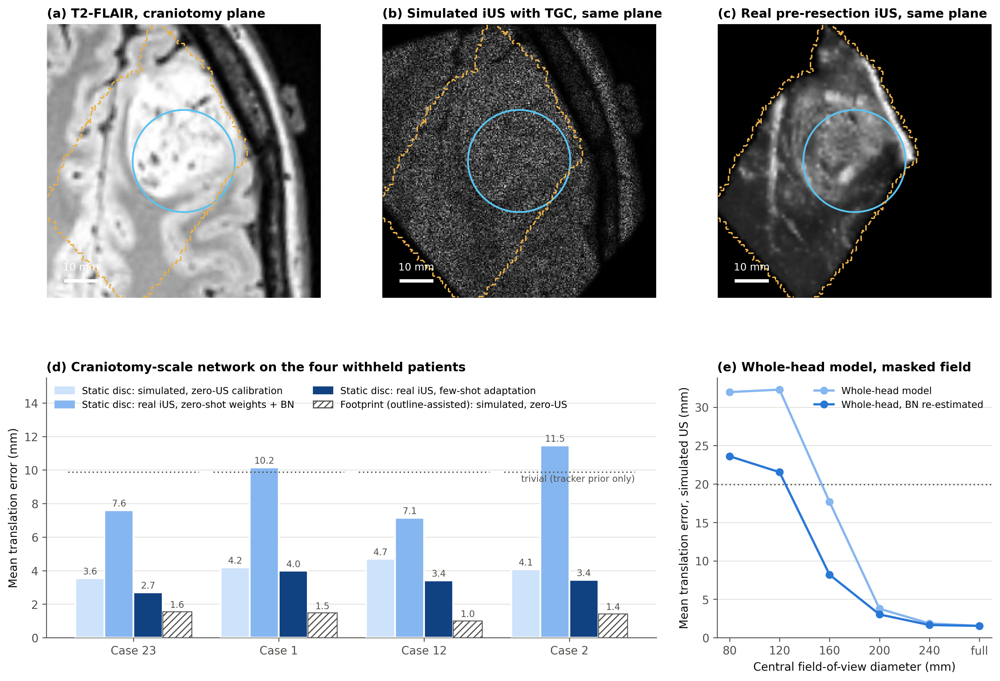

# Real-Time 2D Ultrasound to 3D MRI Slice Matching using Deep Learning

**Continuous SE(3) pose regression on the RESECT database**

Kiyuran Naidoo · supervised by Professor Fred Nicolls · Department of Electrical Engineering, University of Cape Town
(EEE4022S final-year project, topic FCN05, 2026)



This repository estimates where a 2D intra-operative ultrasound (iUS) frame lies inside a patient's pre-operative 3D
MRI volume. It regresses the full six-degree-of-freedom rigid pose in a single forward pass of about 3 ms, and it adapts
to a patient never seen in training with an 18.8 s pre-operative calibration that needs **no ultrasound** from that
patient.

> **Scope of the results.** The primary benchmark uses ultrasound *simulated* from MRI. Accuracy is measured on frames
> simulated from the same pre-operative MRI used for calibration, without brain shift, so it establishes algorithmic
> feasibility under a controlled appearance gap, not clinical accuracy. A separate probe on the real pre-resection
> ultrasound of four withheld patients (below) bounds what transfers to clinical data.

---

## 1. The clinical problem

During glioma resection the brain shifts and deforms, by 25 mm or more, so the pre-operative MRI used for navigation
no longer matches the anatomy. 2D iUS is real-time, safe and inexpensive, but a frame is only useful if its plane is
known within the 3D MRI: a slice-to-volume registration problem on SE(3).

- **Classical registration** is accurate but takes 28 s to about 2.5 min per alignment and needs a tracked
  initialisation.
- **The previous FCN05 project** discretised three parameters into 50 × 5 × 5 classes. Its resolution was capped by the
  bin width, and its error rose from 0.167 mm on seen data to 11.31 mm on an unseen patient.



## 2. Method

| Component | What it does |
| :--- | :--- |
| `VolumeReslicer` (`src/utils/reslicer.py`) | Differentiable GPU reslicing with `grid_sample`. Poses act in physical millimetres with a shared reference half-width h_ref = 127.5 mm, so every slice is rigid and spans 255 mm in every patient. This removes the anisotropic shear S R S⁻¹ of normalised-grid rotation, which compressed a 30° tilt to 23.4°. |
| `AcousticSimulator` (`src/simulator/sim_us.py`) | A five-stage, physics-based B-mode simulator: gradient interface reflection (κ = 0.3), Rayleigh speckle, Beer–Lambert attenuation (0.60 dB cm⁻¹ MHz⁻¹ at 5 MHz), an 80° curvilinear sector and per-slice normalisation. It runs on the GPU inside the training loop, so every pair has an exact pose label. |
| NN1 / NN2 (`src/models/encoders.py`) | Twin 2D ResNet-18 encoders (11,235,904 parameters each) projecting MRI slices and ultrasound frames onto the unit hypersphere S¹²⁷. |
| NN3 (`src/models/pose_regressor.py`) | A shared MLP (134,153 parameters, LayerNorm) with decoupled `xy_head`, `z_head` and a 6D Gram–Schmidt `rot_head` that maps continuously onto SO(3). The total pipeline has 22,605,961 parameters. |
| Loss (`src/losses/pose_loss.py`) | A rescaled translation loss, the squared chordal rotation loss ‖R̂ − R‖²_F = 4(1 − cos θ), and modality alignment with symmetric in-batch InfoNCE over 15 same-brain hard negatives. Each weight is set from the expected loss of the trivial predictor. |
| Stage 1 | Leave-one-subject-out training on 22 patients: 100 epochs × 25 steps × 16 freshly generated pairs (40,000), with a 50-epoch rotation curriculum and the mid-axial canonical plane. It takes about 5 min on an RTX 3050 Laptop GPU. |
| Stage 2 | Zero-ultrasound pre-operative calibration. First, adaptive batch normalisation re-estimates the encoder statistics on 160 reslices of the patient's own MRI with no weight change. Then NN3 and the two projection heads (265,481 parameters) are fine-tuned with the backbones frozen. It takes 18.8 s. |

<p align="center">
  
  
</p>

## 3. Key findings

1. **The slice plane decides observability.** Through the near mirror-symmetric mid-sagittal plane the sign of the
   elevation is ambiguous, so the error grows from 2.84 mm near the midline to 12.80 mm away from it. With the mid-axial
   plane every calibrated translation component falls below 1 mm (0.64 / 0.84 / 0.86 mm), and the training rotation
   loss falls fivefold.
2. **Same-brain negatives prevent representation collapse.** Isolated InfoNCE collapsed: 90.9% of the variance fell
   in one principal component. Alignment-only training collapsed into a cone with an inter-slice cosine of 0.86 and 20%
   retrieval. In-batch repulsion over 15 same-patient negatives gives an inter-slice cosine of 0.18 and **100% top-1
   cross-modal retrieval** on the unseen patient.
3. **The unseen-patient gap is a batch-normalisation statistics shift.** Single-patient training batches leave
   population statistics that match no individual brain. Even a *seen* training patient errs by 9.14 mm until its own
   statistics are used. Re-estimating them with no weight change recovers 75–96% of the calibration gain.

## 4. Results

**Withheld Case 23, Protocol B** (40 slices, ±20 mm, ±30°; trivial centre-and-identity guess: 19.92 mm, 14.62°):

| Pathway | Uncalibrated | BN re-estimation only | Calibrated (18.8 s, no ultrasound) |
| :--- | ---: | ---: | ---: |
| MRI → NN1 → NN3 | 14.28 mm / 4.76° | 2.01 mm | **1.49 mm / 2.09°** |
| Simulated iUS → NN2 → NN3 | 10.37 mm / 5.92° | 2.07 mm | **1.54 mm / 2.13°** |

- **Spread:** 95% of slices lie within 3 mm. The 95% bootstrap CIs are 1.22–1.79 mm (MRI) and 1.29–1.80 mm (simulated iUS).
- **Protocol A** (±15°): 1.14 mm and 1.42 mm.
- **25-seed stability** (5 pose × 5 speckle seeds): 1.69 ± 0.12 mm (simulated iUS) and 1.49 mm (MRI).
- **Inference:** 3.19 ms per frame (314 frames/s) through NN2 and NN3 on an NVIDIA RTX 3050 Laptop GPU.

**Four-fold leave-one-subject-out validation** (Cases 23, 1, 12 and 2; each fold has its own Stage 1 network):

| Mean translation error (mm) | Uncalibrated | BN re-estimation only | Calibrated |
| :--- | ---: | ---: | ---: |
| MRI pathway, mean ± SD | 9.70 ± 3.09 | 2.47 ± 0.57 | **1.56 ± 0.21** |
| Simulated-iUS pathway, mean ± SD | 9.71 ± 1.28 | 2.60 ± 0.48 | **1.73 ± 0.21** |

Top-1 retrieval is 100% in every fold, including the smaller 176 × 224 × 256 volume of Case 2.

**Cross-sequence check (T1-weighted MRI, Case 23).**
- **Under the FLAIR statistics:** the calibrated model errs by 12.29 mm and 8.98 mm.
- **After re-estimation on T1:** 2.89 / 2.90 mm with no weight change, so the same mechanism governs a change of sequence.
- **After a full T1 calibration:** 1.90 / 2.05 mm. The 0.4–0.5 mm residual is the limit of frozen FLAIR-trained filters.

**Real intra-operative ultrasound probe (four patients, craniotomy-centred 80 mm frame).**
- **Alignment:** the RESECT pre-resection volumes are aligned to the MRI by a least-squares rigid fit to 15–16 expert landmark pairs. The leave-one-out error is 1.1–1.6 mm, against 1.8–19.7 mm for the tracked alignment.
- **Leak-free control:** a static 30 mm disc, whose outline carries no pose information. Inside it, the MRI alone localises simulated frames to **4.1 mm**, against **9.9 mm** for the tracker prior.
- **Real ultrasound:** reaches **3.4 mm** after few-shot adaptation. Orientation is not recovered.
- **Why orientation is lost:** a rotation θ moves a point at radius r by ‖δp‖ = 2r sin(θ/2) ≈ rθ. That is 2.2 mm per degree at the edge of a 255 mm slice, but only 0.26 mm per degree at the edge of the 30 mm disc, less than one pixel. A wider effective aperture (a tracked sweep or a 3D probe) is needed for orientation.

<p align="center">
  
  
</p>



Every number above is read from [`docs/case23_benchmark.json`](docs/case23_benchmark.json), which the benchmark
scripts regenerate from the saved checkpoints.

## 5. Repository structure

```
final-year-project/
├── src/
│   ├── models/          encoders.py (NN1, NN2), pose_regressor.py (NN3, 6D Gram–Schmidt), dual_encoder.py
│   ├── losses/          pose_loss.py (translation, chordal rotation, alignment + InfoNCE), contrastive_loss.py
│   ├── simulator/       sim_us.py (five-stage AcousticSimulator)
│   └── utils/           reslicer.py (VolumeReslicer), dataset.py (RESECT loading, RAS reorientation, LOSO splits),
│                        data_loader.py, metrics.py (MTE in mm, geodesic error in degrees)
├── scripts/
│   ├── train_pose_pipeline.py     Stage 1 leave-one-subject-out training
│   ├── calibrate_patient.py       Stage 2 zero-ultrasound calibration
│   ├── case23_benchmark.py        Benchmark of every reported number -> docs/case23_benchmark.json
│   ├── run_loso_folds.py          Additional leave-one-subject-out folds
│   ├── cross_sequence_t1.py       T1-weighted cross-sequence check
│   ├── real_ius_and_fov_probe.py  Field-of-view masking and whole-head real-iUS probe
│   ├── craniotomy_centres.py      Craniotomy centres from the pre-resection ultrasound
│   ├── craniotomy_roi_probe.py    Craniotomy-centred real-iUS probe on four withheld patients
│   ├── latent_feature_pca.py      Joint channel-PCA visualisation of the encoder feature maps
│   ├── train_contrastive.py       Isolated contrastive pre-training study (documented negative result)
│   └── sweep_dataset.py           Dataset integrity sweep
├── tests/               104 pytest unit tests (geometry, rigidity, simulator physics, losses, metrics, calibration, I/O)
├── figures/             Selected result and method figures
├── docs/case23_benchmark.json
├── dataset.py, losses.py, models.py, reslicer.py, sim_us.py   Thin top-level re-exports of src/
└── requirements.txt
```

## 6. Installation

Tested with Python 3.11, PyTorch 2.5.1 (CUDA 12.1) and NumPy 2.3 on Windows 11 with an NVIDIA RTX 3050 Laptop GPU
(4 GB).

```bash
git clone https://github.com/NonchaloirKN/final-year-project.git
cd final-year-project
python -m venv .venv && source .venv/bin/activate      # Windows: .venv\Scripts\activate
pip install -r requirements.txt                          # install the CUDA build of PyTorch for GPU training
```

**Data.** The RESECT database (Y. Xiao *et al.*, "REtroSpective Evaluation of Cerebral Tumors (RESECT)", *Medical
Physics* 44(7):3875–3882, 2017) is not redistributed here. Obtain it from its publishers and place the volumes at
`data/resect_base/RESECT/NIFTI/CaseN/MRI/CaseN-FLAIR.nii.gz` (and `CaseN/US/CaseN-US-before.nii.gz` plus the landmark
tag files for the real-iUS probes). Trained checkpoints are not included; Stage 1 retrains in about five minutes.

## 7. Usage

Run every command from the repository root.

```bash
# Unit tests: 104 pass with the RESECT data present; without it the 3 data-dependent tests skip
# (CUDA-only tests also skip on a CPU-only machine)
pytest -q

# Stage 1: leave-one-subject-out training of the primary model (Case 23 withheld)
python scripts/train_pose_pipeline.py --from_scratch --pretrained --epochs 100 --steps_per_epoch 25 \
    --batch_size 16 --lr 3e-4 --contrastive_weight 0.1 --rot_curriculum_epochs 50 --amp --seed 0 --quiet --log_every 10

# Stage 2: zero-ultrasound calibration on the withheld patient (about 19 s)
python scripts/calibrate_patient.py --case Case23 --epochs 10 --steps_per_epoch 25 --batch_size 16 --lr 3e-4 \
    --variant compare --bn_reestimate --seed 0

# Reproduce every Case 23 number (protocols, ablations, latency), then bootstrap CIs and the 5 x 5 seed study
python scripts/case23_benchmark.py
python scripts/case23_benchmark.py --robustness

# Additional folds: train, calibrate, then evaluate all four withheld patients
python scripts/run_loso_folds.py --stage train --cases Case1 Case12 Case2
python scripts/run_loso_folds.py --stage calibrate --cases Case1 Case12 Case2
python scripts/run_loso_folds.py --stage evaluate --cases Case23 Case1 Case12 Case2

# Cross-sequence (T1-weighted) check
python scripts/cross_sequence_t1.py

# Real-iUS probes: field of view, then the craniotomy-centred design on four patients
python scripts/real_ius_and_fov_probe.py
python scripts/craniotomy_centres.py
python scripts/craniotomy_roi_probe.py --stage train --version v3
python scripts/craniotomy_roi_probe.py --stage evaluate --version v3
```

Training, calibration and the benchmark stop with an error if a volume or checkpoint is missing; a synthetic phantom
is used only when `--allow_synthetic` is passed for a dry run.

## 8. Limitations and next steps

- **Simulated frames:** the primary benchmark uses simulated ultrasound without brain shift. Validation on real, tracked, streamed 2D iUS is the decisive next experiment.
- **Rigid pose only:** the pipeline estimates a rigid pose. It is designed as the real-time initialiser for deformable brain-shift correction (learned or biomechanical), not as a replacement for it.
- **Four folds:** four of 23 folds were evaluated. A full 23-fold evaluation is affordable at about five minutes of training per fold.
- **Batch-composition dependence:** replacing batch normalisation with group or layer normalisation, or mixing patients within Stage 1 batches, should remove the statistics shift at its source.

## Acknowledgements

Professor Fred Nicolls supervised this work. The RESECT database was made available by Xiao *et al.* (2017).
